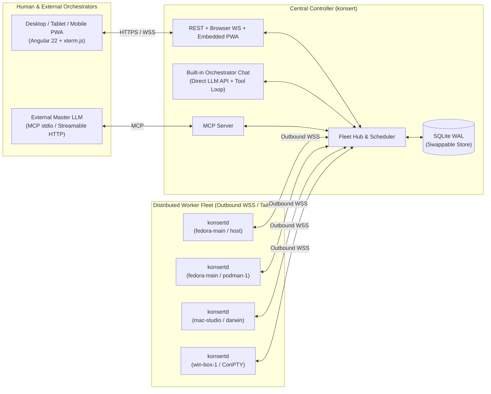
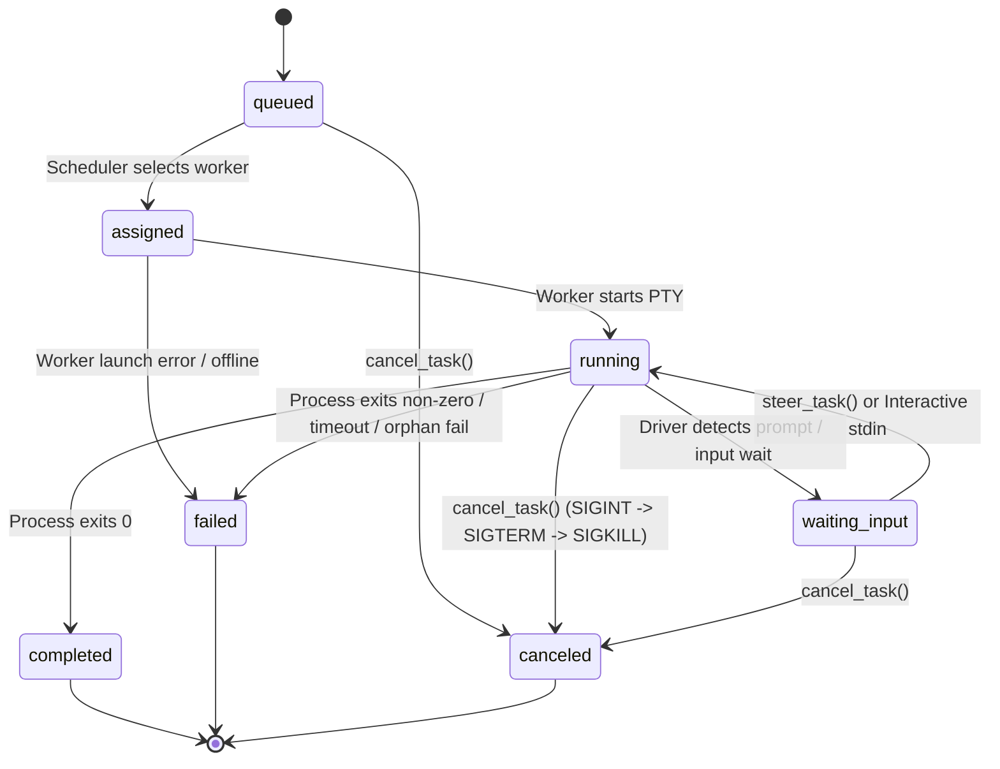

# Product Requirements Document: Konsert (`konsert.dev` / `konsert.app`)

| Field | Value |
| :--- | :--- |
| **License** | Apache License 2.0 |
| **Version** | 1.0 (MVP Specification) |
| **Target Stack** | Go 1.24+ (`konsert`, `konsertd`), SQLite (`modernc.org/sqlite`, swappable `Store` interface), Angular 22+ (Zoneless Signals PWA, Tailwind CSS v4), `@xterm/xterm`, MCP (Model Context Protocol) |
| **Target Audience** | Homelab builders, distributed engineering teams, and power users running multi-node autonomous coding fleets across physical hosts, VMs, and containers |

---

## 1. Executive Summary & Problem Statement

Autonomous multi-agent coding workflows rely on a central **orchestrator** (e.g., an LLM session via MCP or Konsert's built-in Orchestrator Chat) delegating parallel tasks across multiple physical machines, VMs, and isolated Podman/Docker containers.

Today, observing what worker nodes are doing forces users into one of two bad workflows:
1. Manually SSH-ing or `podman exec`-ing into scattered hosts and tmux sessions.
2. Asking the orchestrator LLM to poll and summarize raw worker terminal logs—burning input/output tokens and polluting the orchestrator's context window with noisy ANSI escape sequences and build output.

**Konsert** is a single-binary, self-hosted distributed agent control plane that cleanly decouples **LLM orchestration** from **human observability**:

- **Orchestrators** dispatch tasks, query fleet capacity, steer running agents, and retrieve concise, structured completion payloads (exit code, git diff summary, final agent summary) via MCP or REST/CLI—**never ingesting raw worker stdout**.
- **Humans** get a unified, responsive IDE-style PWA ("single pane of glass") across desktop, tablet, and mobile to monitor all fleet nodes, inspect structured progress milestones, and attach to live **Read-Only** (or **Interactive Takeover**) PTY sessions on demand.

---

## 2. Goals & Non-Goals (MVP Scope)

### 2.1 MVP Goals
- Single-binary controller (`konsert`) with embedded Angular 22 PWA (`//go:embed`) and zero external database dependencies (SQLite WAL mode out of the box).
- Cross-platform worker daemon (`konsertd`) for Linux, macOS, Windows, and Podman/Docker containers using **outbound-only** WebSocket connections.
- Pluggable `AgentDriver` abstraction shipping with `claude`, `agy`, and `grok` drivers (plus a deterministic `mock` driver for CI/testing).
- **Full-Access ("YOLO") execution by default** for trusted homelab/VM/container fleets, with explicit **opt-in sandboxing** for restricted hosts.
- Built-in **Orchestrator Chat Tab** powered by direct LLM API tool-calling (OpenAI-compatible, Anthropic, Gemini) wired directly to Konsert's fleet control plane, alongside an **MCP Server** (stdio + Streamable HTTP/SSE) for external orchestrators.
- Zero-waste on-demand PTY streaming: worker nodes buffer locally (512 KB ring buffer) and stream PTY bytes only while a human has that session open.

### 2.2 Explicit Non-Goals (Post-MVP)
- Multi-tenant SaaS / organization RBAC (MVP targets single-operator or trusted-team homelab/LAN/Tailscale deployments).
- Hosted cloud relay service (users connect over Tailscale, LAN, or their own reverse proxy / HTTPS endpoint).
- Production PostgreSQL 18 driver implementation (MVP defines the swappable `Store` interface and implements SQLite; PostgreSQL is a Phase 5+ drop-in).
- Built-in code editor / file browser (Konsert focuses on orchestration, telemetry, and terminal observability).

---

## 3. System Topology & Deployment Model

### 3.1 Binary Roles
1. **`konsert` (Central Controller / Hub):**
   - Runs on a primary host accessible over Tailscale or LAN/HTTPS.
   - Serves the embedded Angular 22 PWA (`//go:embed`), REST API, Browser WebSocket endpoint, Worker WebSocket endpoint, and MCP Server (stdio and Streamable HTTP/SSE).
   - Runs the built-in Orchestrator Chat backend (direct LLM API client with server-side tool execution).
   - Persists workers, tasks, structured events, and orchestrator chat history in SQLite (WAL mode) behind a swappable Go `Store` interface.
2. **`konsertd` (Cross-Platform Worker Daemon):**
   - Runs natively on Linux (`amd64`/`arm64`), macOS (`arm64`/`amd64`), Windows (`amd64`), and inside Podman/Docker containers.
   - Initiates an **outbound** authenticated WebSocket connection (`wss://` or `ws://` over Tailscale) to `konsert`, eliminating NAT, WSL2 bridge, and container port-forwarding issues.
   - Detects installed agent CLIs, manages PTY/ConPTY sessions, maintains a local 512 KB ring buffer per session, scrapes agent-specific structured telemetry, and handles git worktree isolation and diff summarization.

---

## 4. Core User Journeys

1. **Automated Parallel Dispatch (Orchestrator-Driven):**
   - User asks the built-in Orchestrator Chat (or an external MCP-connected LLM) to implement three independent features across repos.
   - Orchestrator calls `fleet_status()` to inspect idle workers and available drivers, then calls `dispatch_task()` for each task.
   - Orchestrator monitors progress via `list_tasks()` or awaits completion via `get_task_result(task_id, wait=true)`, receiving only structured exit codes, git diff stats, and final summaries.
2. **Zero-Friction Live Observation (Human PWA):**
   - User sees three active tasks light up in the left Fleet Explorer under `fedora-main` (2 Podman workers) and `mac-studio`.
   - User clicks a worker task to open a Read-Only `@xterm/xterm` tab. `konsertd` immediately replays its 512 KB ring buffer and begins streaming live PTY frames.
   - User inspects structured milestones (files edited, commands run) in the Telemetry Drawer without interrupting the agent.
3. **Interactive Takeover:**
   - A task enters `waiting_input` or hits a tricky local environment issue.
   - User clicks **"Take Control / Interactive"** in the terminal tab header, types directly into the remote PTY (or sends a follow-up prompt), resolves the issue, and toggles back to Read-Only.
4. **Mobile Check-In & Steering:**
   - Away from desk, user opens the installed Konsert PWA on their phone (`< 768px` layout).
   - User opens the slide-over Fleet drawer, checks task status, and sends a steering instruction through the Orchestrator Chat tab or `steer_task`.
5. **Controller Restart Resilience:**
   - Operator upgrades or restarts `konsert`. Running `konsertd` daemons keep their active PTY processes alive, reconnect with exponential backoff, and re-register their in-flight tasks so no agent work is lost.

---

## 5. Functional Requirements

### 5.1 Fleet & Worker Management
- **Auto-Registration & Metadata:** On connect, `konsertd` authenticates with a pre-shared fleet token and registers:
  - `id` (stable UUID or operator-defined slug)
  - `name` (display name / hostname)
  - `host_group` (e.g., `fedora-main`, `win-box-1` — used to nest Podman/Docker containers or VMs under their physical host)
  - `os` (`linux`, `darwin`, `windows`) and `arch` (`amd64`, `arm64`)
  - `isolation` (`vm`, `container`, `host`)
  - `permission_mode` (`full_access` default, or `sandboxed` when opted-in)
  - `agents` (detected binaries, e.g., `["claude", "agy", "grok"]`)
  - `tags` (arbitrary key/value metadata, e.g., `{"env": "podman", "gpu": "rtx4090"}`)
  - `max_concurrent` (maximum simultaneous tasks on this worker)
- **Heartbeats & Health:**
  - `konsertd` sends heartbeats every `10s` (including active task count and optional host load).
  - `konsert` marks a worker `offline` after `30s` of missed heartbeats.
  - **Orphan Policy:** Configurable per task (`orphan_policy`: `fail` default, or `requeue`). When a worker reconnects after a transient drop, any still-running tasks reported in its `worker.hello` handshake are re-adopted instead of failed.

### 5.2 Execution Trust Model: Full-Access ("YOLO") Default & Opt-In Sandboxing
Konsert is built for homelab and professional distributed fleets where worker nodes are typically VMs, containers, or dedicated dev machines with known risk boundaries. **Bubble-wrapping is opt-in, never forced by default:**

- **Default Mode (`full_access` / YOLO):**
  - `konsertd` places **no filesystem root restrictions** on `workdir` unless explicitly configured.
  - Every `AgentDriver` launches its underlying CLI with full-access / skip-permissions / auto-approve flags enabled by default (e.g., `claude --dangerously-skip-permissions`, and the equivalent full-access flags for `agy` and `grok`).
  - Agents can run shell commands, edit files, install packages, and commit git changes without stalling on interactive confirmation prompts.
- **Opt-In Sandboxed Mode (`sandboxed`):**
  - Operators who run `konsertd` on a sensitive host can opt into restrictions via CLI flags or config:
    - `--sandbox` (or `permission_mode: sandboxed`): Disables agent YOLO/skip-permissions flags so the agent respects its normal permission prompts (which can be answered via Interactive Takeover or `steer_task`).
    - `--allowed-roots /path/a,/path/b`: Restricts task `workdir` (resolved via symlink-safe `filepath.EvalSymlinks`) to the specified root directories.
  - Individual tasks may also request `permission_mode: "sandboxed"` to downgrade permissions for a single run, while a `sandboxed` worker refuses `full_access` escalation.
- **UI Visibility:** Each worker in the Fleet Explorer displays its isolation tier (`VM`, `Container`, `Host`) and permission posture (`Full Access` vs `Sandboxed`).

### 5.3 Multi-Agent Execution Engine (`AgentDriver`)
- **Pluggable Driver Interface:** Konsert never hardcodes vendor-specific CLI flags or log formats into the core daemon.
- **MVP Drivers:**
  1. **`claude` (Claude Code CLI):** Spawns in PTY with `--dangerously-skip-permissions` (in default `full_access` mode), tails `~/.claude/projects/<encoded-workdir>/*.jsonl` for structured tool calls, file edits, token usage, and final assistant summary.
  2. **`agy` (Google Antigravity CLI):** Spawns in PTY with full-access default, parses structured status/milestone output and extracts final summary.
  3. **`grok` (Grok CLI):** Spawns in PTY with auto-approve/full-access default, captures exit status and extracts final summary.
  4. **`mock` (Built-in Test Driver):** Deterministic scripted driver emitting synthetic PTY frames and telemetry events for CI and local UI development without LLM credentials.
- **Extensible Registry:** Adding `codex`, `muse`, `copilot`, or `cursor-agent` requires implementing `AgentDriver` and calling `drivers.Register(...)`.

### 5.4 Git Worktree Isolation & Diff Extraction
- When `dispatch_task` specifies a non-empty `branch`:
  - By default (`use_worktree: true`), `konsertd` creates an isolated git worktree at `<repo_path>/.konsert-worktrees/<task_id>` checked out to `branch` (creating the branch if it does not exist), allowing multiple concurrent tasks on the same worker and repository without file collisions.
  - When `branch` is empty (or `use_worktree: false`), the task runs directly in `repo_path`.
- On task completion, `konsertd` captures:
  - `git status --short`
  - `git diff --stat` (against the task's starting commit SHA)
  - Newly created commits (`git log --oneline <base_sha>..HEAD`)
  - These structured git summaries are attached to the task result without dumping raw patches into the orchestrator's context.

### 5.5 Task Lifecycle & State Machine

- **Execution Modes (`mode`):**
  - `oneshot` (default): Runs the prompt to completion and exits, returning exit code, git diff summary, and final summary.
  - `interactive`: Starts a persistent session that remains open after initial completion so the orchestrator (`steer_task`) or human (Take Control) can issue follow-up turns until explicitly canceled or exited.
- **Timeouts & Cancellation:**
  - Optional `timeout_seconds` per task (default: `3600` / 1 hour, `0` = unlimited).
  - `cancel_task` sends `SIGINT` to the PTY process group (Unix `PGID`) or Windows Job Object, escalating to `SIGTERM` after 5s and `SIGKILL` / terminate after 10s.

### 5.6 Orchestrator Interfaces

#### 5.6.1 Built-in Orchestrator Chat Tab (Direct LLM API)
- First-class chat interface in the PWA backed by a server-side `OrchestratorService` inside `konsert`.
- Connects directly to user-configured LLM APIs via a provider adapter:
  - **OpenAI-compatible** (covers OpenAI, OpenRouter, xAI/Grok, Ollama, vLLM, LiteLLM)
  - **Anthropic Messages API**
  - **Google Gemini API**
- Runs a native server-side tool-calling loop invoking the exact same internal fleet service methods exposed by MCP (`fleet_status`, `dispatch_task`, `list_tasks`, `get_task_result`, `steer_task`, `cancel_task`).
- Streams assistant tokens and structured tool-call/result cards over the browser WebSocket and persists conversations in SQLite (`chat_sessions`, `chat_messages`).
- Never injects raw PTY stdout into the model context.

#### 5.6.2 MCP Tool Surface (`konsert mcp`)
Exposed over both **stdio** (for local desktop/CLI orchestrators) and **Streamable HTTP / SSE** (for remote orchestrators):

| Tool | Arguments | Returns (Concise Structured JSON) |
| :--- | :--- | :--- |
| `fleet_status` | *(none)* | List of workers (`id`, `name`, `host_group`, `os`, `arch`, `isolation`, `permission_mode`, `agents`, `tags`, `status`, `active_tasks`, `max_concurrent`) and active task count |
| `dispatch_task` | `worker_selector` (object: `worker_id`, `host_group`, `os`, `tags`), `agent`, `repo_path`, `branch?`, `use_worktree?`, `prompt`, `mode?` (`oneshot`\|`interactive`), `permission_mode?`, `timeout_seconds?` | `{ task_id, worker_id, status, workdir_effective }` |
| `list_tasks` | `status_filter?`, `worker_id?`, `limit?` (default 50) | Array of `{ task_id, worker_id, agent, status, branch, elapsed_seconds, last_milestone }` |
| `get_task_result` | `task_id`, `wait?` (bool, default `false`), `timeout_seconds?` (default `300`) | `{ task_id, status, exit_code, duration_seconds, summary, git_summary: { base_sha, head_sha, commits, diff_stat, dirty_files }, recent_milestones }` |
| `steer_task` | `task_id`, `input_text`, `append_newline?` (default `true`) | `{ ok, task_id, status }` |
| `cancel_task` | `task_id` | `{ ok, task_id, status }` |

#### 5.6.3 CLI Commands
- `konsert serve` — Starts the controller hub, web UI, REST/WS API, and optional HTTP MCP endpoint.
- `konsert mcp` — Runs the stdio MCP bridge (talking to local SQLite or remote `konsert` HTTP API).
- `konsert token generate` — Generates secure fleet and UI auth tokens.
- `konsert status` / `konsert dispatch` / `konsert tasks` — Lightweight CLI wrappers over the controller REST API.
- `konsertd run` — Starts the worker daemon and connects outbound to `konsert`.
- `konsertd doctor` — Verifies detected agent CLIs, git availability, PTY support, and connectivity to `konsert`.

### 5.7 Human Observability UI (Angular 22+ Zoneless Signals PWA)
- **Visual Direction:** Dark-mode IDE aesthetic inspired by VS Code, Herdr, and Orca; crisp monospace telemetry, high-contrast status indicators, zero clutter.
- **3-Zone Desktop Layout (`>= 768px`):**
  1. **Left Rail & Fleet Explorer:** Collapsible tree grouping workers under `host_group` (physical host → nested Podman/VM workers). Each node displays live status dot (`idle`, `running`, `waiting_input`, `error`, `offline`), isolation/permission badge (`Full Access` / `Sandboxed`), active agent badge (`claude`, `agy`, `grok`), and live elapsed timer.
  2. **Center Multi-Tab Workspace:**
     - Persistent pinned **Orchestrator Chat** tab.
     - Dynamic **Worker Session Tabs** rendered with `@xterm/xterm` (`FitAddon`, `WebglAddon` with canvas fallback, `WebLinksAddon`).
     - **Per-Tab View Mode:** Defaults to **Read-Only** (blocks accidental keyboard input; shows lock indicator) with an explicit **"Take Control / Interactive"** toggle button that enables stdin forwarding and visually highlights the active border.
     - Tab header shows worker name, agent, branch, status pill, quick **Cancel**, and **Scroll to Bottom** controls.
  3. **Right / Bottom Telemetry Drawer (collapsible):** Structured timeline of `TaskEvent` milestones (`tool_call`, `file_edit`, `milestone`, `error`, `exit`), git branch/diff summary, and task metadata.
- **Responsive Mobile & Tablet PWA (`< 768px`):**
  - Installable Web App Manifest (`manifest.webmanifest`) + Angular Service Worker (`@angular/service-worker`) for offline shell caching and fast home-screen launch.
  - Fleet Explorer collapses into a swipeable/toggleable slide-over drawer.
  - Compact top tab switcher between Orchestrator Chat and open worker sessions.
  - Touch-friendly quick action bar above mobile keyboard when Interactive mode is enabled (`Ctrl+C`, `Esc`, `Tab`, `Enter`).

---

## 6. Non-Functional Requirements

### 6.1 Security & Access Control
- **Worker Auth:** `Authorization: Bearer <fleet_token>` on outbound WebSocket upgrade. Constant-time token comparison.
- **Browser PWA Auth:** Configurable admin token/passphrase login issuing an `HttpOnly; SameSite=Strict` signed session cookie. Supports trusted reverse-proxy / Tailscale identity header bypass (`--trust-tailscale-headers`) for zero-friction Tailscale Serve deployments, and `--no-auth` for isolated local-only testing.
- **MCP HTTP Auth:** Bearer token authentication on Streamable HTTP/SSE endpoints.
- **Audit Events:** Interactive takeover enable/disable and `steer_task` invocations are logged as `TaskEvent` records (`kind: "control"`) for visibility.

### 6.2 Performance & Bandwidth
- **Zero Idle PTY Traffic:** While `subscriber_count == 0`, `konsertd` writes PTY output only to its local 512 KB circular buffer—zero bytes sent to `konsert`.
- **Fast Attach:** Ring buffer snapshot replay completes in `< 200ms` over LAN/Tailscale.
- **Backpressure Protection:** Browser WebSocket send queues are bounded; slow/stalled browser clients are dropped/disconnected rather than blocking the worker PTY or other viewers.

### 6.3 Reliability & Cross-Platform Support
- **Worker Reconnect:** Exponential backoff with jitter (`1s` → `30s` cap) on WebSocket disconnect.
- **Process Cleanup:** Clean process-group teardown on `cancel_task` and daemon shutdown (`SIGTERM`), preventing zombie agent subprocesses.
- **SQLite Durability:** `PRAGMA journal_mode=WAL; PRAGMA synchronous=NORMAL; PRAGMA busy_timeout=5000; PRAGMA foreign_keys=ON;` with single-writer connection tuning to prevent `SQLITE_BUSY`.
- **Supported Platforms:** Linux (`amd64`, `arm64`), macOS (`arm64`, `amd64`), Windows (`amd64` ConPTY), Podman/Docker Linux containers.
